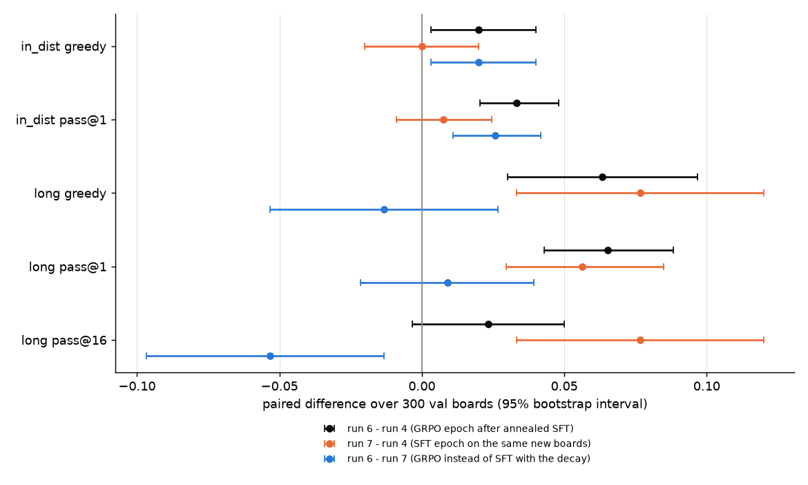

# What GRPO adds to SFT on single-turn Sokoban

Qwen2.5-0.5B-Instruct, 7×7 boards, one seed per run. All numbers are on validation boards; the test split has not
been evaluated.

## Summary

The study compares one more epoch of GRPO with one more epoch of SFT, from the same starting model and on the same
boards. SFT targets are BFS-optimal solutions, generated without manual annotation, so the setting favors SFT.

The runs, each with the in-distribution greedy solve rate of its final model on the validation boards:

```text
base model                                                                0.033
└── SFT model: SFT, 3 epochs on the SFT part, constant lr                 0.870
    ├── run 1: GRPO, one more epoch on the RL part                        0.937
    ├── run 2: SFT,  one more epoch on the RL part, constant lr           0.847
    ├── run 3: SFT,  one more epoch on the RL part, lr decayed to 0       0.937
    ├── run 4: SFT,  one more epoch on the SFT part, lr decayed to 0      0.933
    │   ├── run 6: GRPO, one more epoch on the RL part                    0.953
    │   └── run 7: SFT,  one more epoch on the RL part, lr decayed to 0   0.933
    └── run 5: SFT,  one more epoch on the SFT part, constant lr          0.833
```

The SFT part is the 25,000 training boards the SFT model was trained on; the RL part is 25,000 other training
boards, which no starting model has seen. Brackets below are 95% intervals (§3).

- **The SFT schedule changed the conclusion** (§5.1). On the new boards of the RL part, one more epoch of GRPO
  (run 1) reached 0.937, against 0.847 for one more SFT epoch at the SFT model's constant learning rate (run 2). The
  same SFT epoch with the learning rate decayed to 0 (run 3) also reached 0.937.
- **GRPO–SFT difference after the decay** (§5.2). GRPO against SFT with the decay, each from the same start on the RL
  part: in-distribution pass@1 differed by +0.000 [−0.017, 0.017] from the SFT model (run 1 − run 3) and by +0.026
  [0.011, 0.042] from run 4 (run 6 − run 7). On boards longer than any seen in training, GRPO showed no clear
  advantage in greedy solve rate or pass@1 in either comparison, and SFT had higher coverage with 16 samples per
  board (pass@16 −0.057 and −0.053 for GRPO).
- **Mixed-reward groups** (§5.3). Only groups whose 8 answers do not all get the same reward contribute to GRPO's
  policy gradient. Predicted before training from the starting model's samples: 0.264 of the groups for run 1 and
  0.135 for run 6; measured in the first 100 steps: 0.273 and 0.148; in the last 100 steps: 0.091 and 0.075.
- **Cost** (§5.4). In this implementation and on this GPU, a GRPO step took about 14 times as long as an SFT step.

## 1. Task

A board is a 7×7 Sokoban room with one box (or two, in one held-out bucket). The model sees it once, as text, and
answers with one line of moves; there is no feedback during the answer.

- **Prompt.** One user message through the model's chat template: the board with one symbol per cell separated by
  spaces (`#` wall, `_` floor, `.` target, `$` box, `@` player, ...), the legend, the rules, and the answer format with
  an example.
- **Answer.** `Answer: up up left ...`, one line. The parser is strict: anything else is a parse failure.
- **Reward.** The moves are executed from the start state. Bumping into a wall or pushing a blocked box is a no-op
  that still uses a move. Execution stops at the first solved state, and at most `budget = 2 × optimal length` moves
  are executed. The reward is 1 if the board is solved within the budget, else 0. A parse failure gets 0, and so does
  an answer cut off by the 128-token limit.
- **Boards.** A seeded random generator places at most 25% walls on the interior (the floor must stay connected), a
  target, a box and the player; a BFS solver keeps only solvable boards and stores an optimal solution and its length
  for each.
- **Split.** Boards with the same walls and targets, up to the 8 rotations and reflections, count as one problem (a
  layout class). A salted hash puts each class in train, val or test (80/10/10), and each split holds at most one board
  per class, so no problem appears in two splits. Buckets:

  | bucket | boxes | optimal length | train | val | test |
  |---|---|---|---|---|---|
  | in_dist | 1 | 1–13 | 50,000 | 300 | 500 |
  | long | 1 | ≥ 14 | — | 300 | 500 |
  | two_box | 2 | any | — | 300 | 500 |

  The 50,000 training boards are split once more into two parts of 25,000 with the same share of every optimal
  length: the **SFT part**, which the first SFT run trains on, and the **RL part**, which none of the starting models
  has seen.

## 2. Training

All training uses TRL 1.14.2 with fp32 weights, gradients and AdamW states, bf16 autocast and gradient checkpointing,
on one RTX 5090. Every evaluation uses a bf16 copy of the weights.

- **SFT** (`SFTTrainer`). The target is the stored optimal solution as an answer line, followed by `<|im_end|>`. The
  loss is the mean negative log-likelihood of the target tokens only. Batches hold 16 boards. AdamW (fused, weight
  decay 0, gradient clipping at norm 1), learning rate 2e-5 after 50 warmup steps, then either constant or decayed
  linearly to 0 at the last step.
- **GRPO** (`GRPOTrainer`). Every step takes 16 boards and samples 8 answers per board at temperature 1 from the full
  distribution (no top-k or top-p), at most 128 tokens. The reward is the binary reward of §1. Learning rate 1e-6,
  constant, no warmup. Everything else stays at TRL's defaults: `loss_type="dapo"`, `beta=0` (no KL term),
  `scale_rewards="group"`, `epsilon=0.2`, one optimization pass per batch of samples. In both GRPO runs, our own
  per-step reward mean and share of all-equal groups matched TRL's logged values at every step.

## 3. Evaluation

Every model is the final checkpoint of its run. The SFT model's run is the best of three seeds by val score (§4);
no other run or checkpoint was chosen by validation score. Each model is evaluated on the first 300 val boards of
each bucket: one greedy answer and 16 sampled answers at temperature 1 per board.

For board $i$ of a bucket, let $g_i \in \{0, 1\}$ be the reward of the greedy answer and $c_i$ the number of the 16
samples that solve it. Then

$$
\text{greedy} = \frac{1}{300}\sum_i g_i, \qquad
\text{pass@1} = \frac{1}{300}\sum_i \frac{c_i}{16}, \qquad
\text{pass@16} = \frac{1}{300}\sum_i \mathbf{1}[c_i \ge 1].
$$

pass@1 is the expected solve rate of one sample. pass@16 is the share of boards that at least one of 16 samples
solves: coverage within a budget of 16 samples. A board that no sample solves can still have a nonzero solve
probability.

Two models are compared board by board: the difference is the mean over the 300 boards of the per-board difference.
Its interval is the 2.5–97.5 percentile range of that mean over 10,000 bootstrap resamples of the boards. The
intervals cover the choice of boards, not training randomness: each run has one seed.

## 4. Runs

Every run after SFT is one more epoch, about 25,000 boards: 1,563 SFT steps or 1,562 GRPO steps of 16 boards. The
Summary shows the same runs as a tree.

| model | short name | starts from | objective | boards | learning rate |
|---|---|---|---|---|---|
| SFT | | base model | SFT, 3 epochs (4,689 steps) | SFT part | 2e-5, constant |
| run 1 | SFT + GRPO | SFT | GRPO | RL part | 1e-6, constant |
| run 2 | SFT + SFT (constant) | SFT | SFT | RL part | 2e-5, constant |
| run 3 | SFT + SFT (decay) | SFT | SFT | RL part | 2e-5, decayed to 0 |
| run 4 | SFT + SFT (decay, seen boards) | SFT | SFT | SFT part | 2e-5, decayed to 0 |
| run 5 | SFT + SFT (constant, seen boards) | SFT | SFT | SFT part | 2e-5, constant |
| run 6 | run 4 + GRPO | run 4 | GRPO | RL part | 1e-6, constant |
| run 7 | run 4 + SFT (decay) | run 4 | SFT | RL part | 2e-5, decayed to 0 |

The SFT model's learning rate and schedule (constant after 50 warmup steps) come from an earlier learning-rate sweep
scored on the same val boards (not part of this release). Three runs with these settings and different seeds reached val
in_dist greedy 0.82–0.87; the SFT model is the best of them (the other two are not part of this release). Runs 1 and 2
were the planned comparison; runs 3–7 were added one at a time after it, each to remove a difference the previous
comparison had left.

## 5. Results

| model | in_dist greedy | in_dist pass@1 | in_dist pass@16 | long greedy | long pass@1 | long pass@16 |
|---|---|---|---|---|---|---|
| base model | 0.033 | 0.026 | 0.127 | 0.000 | 0.000 | 0.000 |
| SFT | 0.870 | 0.829 | 0.953 | 0.117 | 0.101 | 0.250 |
| run 1 (SFT + GRPO) | 0.937 | 0.920 | 0.970 | 0.193 | 0.185 | 0.293 |
| run 2 (SFT + SFT, constant) | 0.847 | 0.819 | 0.953 | 0.110 | 0.086 | 0.223 |
| run 3 (SFT + SFT, decay) | 0.937 | 0.919 | 0.973 | 0.220 | 0.185 | 0.350 |
| run 4 (SFT + SFT, decay, seen) | 0.933 | 0.910 | 0.973 | 0.190 | 0.176 | 0.320 |
| run 5 (SFT + SFT, constant, seen) | 0.833 | 0.805 | 0.927 | 0.117 | 0.088 | 0.213 |
| run 6 (run 4 + GRPO) | 0.953 | 0.944 | 0.977 | 0.253 | 0.241 | 0.343 |
| run 7 (run 4 + SFT, decay) | 0.933 | 0.918 | 0.970 | 0.267 | 0.232 | 0.397 |

On two_box, no model solves more than 0.027 of the boards greedily (all values in `results.json`).

### 5.1 Effect of the SFT learning-rate schedule

In-distribution greedy solve rate after one more epoch from the SFT model (0.870):

| boards of the extra epoch | SFT, constant lr | SFT, lr decayed to 0 | GRPO |
|---|---|---|---|
| new (RL part) | run 2: 0.847 | run 3: 0.937 | run 1: 0.937 |
| already trained on for 3 epochs (SFT part) | run 5: 0.833 | run 4: 0.933 | — |

The in-training evaluations of the same 300 boards, every 250 steps, show the two schedules apart. From step 250 to
the end, the constant-lr runs (2 and 5) moved between 0.823 and 0.890 without a trend, while the decayed runs (3 and
4) rose to 0.930–0.940 at the end.

Paired differences of the in-distribution greedy solve rate:

| comparison | what differs | difference |
|---|---|---|
| run 1 − run 2 | GRPO instead of SFT at a constant lr | +0.090 [0.053, 0.130] |
| run 3 − run 2 | lr decay, on new boards | +0.090 [0.053, 0.127] |
| run 4 − run 5 | lr decay, on boards already trained on | +0.100 [0.063, 0.140] |
| run 3 − run 4 | new instead of already-trained boards, with the decay | +0.003 [−0.017, 0.027] |
| run 2 − run 5 | new instead of already-trained boards, constant lr | +0.013 [−0.030, 0.057] |
| run 2 − SFT | one more epoch at a constant lr, new boards | −0.023 [−0.063, 0.013] |
| run 5 − SFT | one more epoch at a constant lr, boards already trained on | −0.037 [−0.073, 0.000] |
| run 1 − run 3 | GRPO instead of SFT with the decay | +0.000 [−0.023, 0.023] |

With the same amount of extra training, the SFT schedule changed the result: GRPO's lead over the constant-lr SFT
epoch (+0.090) is the size of what the decay adds on the same boards (+0.090). The decay adds about as much on boards
already trained on, so new boards were not needed for the gain. One more epoch at a constant learning rate did not
raise the solve rate over the SFT model, whose val score is optimistic (§6). The long bucket shows the same pattern
(`results.json`).

### 5.2 GRPO against SFT with the decay

Run 6 trains GRPO from run 4. Against run 4 it gains in_dist pass@1 +0.033 [0.020, 0.048] and long greedy +0.063
[0.030, 0.097]. But run 6 has also trained one more epoch on boards run 4 never saw. Run 7 does that epoch with SFT
with the decay instead, from the same start and on the same boards, and run 6's gain can be written as a sum of two
differences:

$$
y^{(6)} - y^{(4)} = \underbrace{\left(y^{(7)} - y^{(4)}\right)}_{\text{one more SFT epoch on the new boards}}
+ \underbrace{\left(y^{(6)} - y^{(7)}\right)}_{\text{GRPO instead of SFT (decay) for that epoch}}
$$

where $y^{(k)}$ is a metric of run $k$ (one of §3, averaged over the 300 boards of a bucket). The second term is the
GRPO–SFT difference under the tested configurations. Runs 6 and 7 share the start and the boards but differ in the
objective and in the learning-rate schedule (§6), so the sum is arithmetic, not a separation of causes.

| metric | run 6 − run 4 | run 7 − run 4 | run 6 − run 7 |
|---|---|---|---|
| in_dist greedy | +0.020 [0.003, 0.040] | +0.000 [−0.020, 0.020] | +0.020 [0.003, 0.040] |
| in_dist pass@1 | +0.033 [0.020, 0.048] | +0.007 [−0.009, 0.024] | +0.026 [0.011, 0.042] |
| long greedy | +0.063 [0.030, 0.097] | +0.077 [0.033, 0.120] | −0.013 [−0.053, 0.027] |
| long pass@1 | +0.065 [0.043, 0.088] | +0.056 [0.030, 0.085] | +0.009 [−0.021, 0.039] |
| long pass@16 | +0.023 [−0.003, 0.050] | +0.077 [0.033, 0.120] | −0.053 [−0.097, −0.013] |



- **long.** One more SFT epoch on the same new boards matched run 6's gain on longer boards. The GRPO–SFT difference
  shows no clear advantage for GRPO in greedy or pass@1 (−0.013 and +0.009, both intervals including 0), and SFT
  achieved higher long-board coverage with 16 samples per board (pass@16 −0.053).
- **in_dist.** The GRPO–SFT difference is pass@1 +0.026 [0.011, 0.042]. The greedy +0.020 rests on 8 boards whose
  greedy outcome differs between run 6 and run 7 (7 solved only by run 6, 1 only by run 7).

**The same comparison from the SFT model.** Run 1 − run 3 compares GRPO with SFT with the decay in the same way, one
epoch on the RL part, but from the SFT model instead of run 4:

| metric | run 1 − run 3 (from SFT) | run 6 − run 7 (from run 4) |
|---|---|---|
| in_dist greedy | +0.000 [−0.023, 0.023] | +0.020 [0.003, 0.040] |
| in_dist pass@1 | +0.000 [−0.017, 0.017] | +0.026 [0.011, 0.042] |
| long greedy | −0.027 [−0.067, 0.013] | −0.013 [−0.053, 0.027] |
| long pass@1 | +0.000 [−0.028, 0.028] | +0.009 [−0.021, 0.039] |
| long pass@16 | −0.057 [−0.097, −0.017] | −0.053 [−0.097, −0.013] |

On in_dist, the GRPO–SFT difference is +0.000 from one start and +0.026 from the other; with one run each, neither
is a general size for this setting. On long boards the two comparisons agree: no clear advantage for GRPO in greedy
or pass@1, and lower coverage with 16 samples.

### 5.3 Mixed-reward groups during GRPO training

A GRPO step samples $G = 8$ answers for each of its 16 boards. Answer $j$ of a board gets the advantage
$A_j = (r_j - \bar r) / (s + \varepsilon)$, where $r_1, \dots, r_8$ are the rewards of the board's 8 answers, $\bar r$
their mean, $s$ their standard deviation and $\varepsilon$ a small constant (TRL's `scale_rewards="group"`). If all 8
rewards are equal (all solved or all failed), every $A_j = 0$, and with `beta=0` (no KL term) the group contributes
no policy-loss gradient. Only groups with mixed rewards, on boards the model solves sometimes but not every time,
contribute.

**Prediction before training.** If each sample solves a board independently with probability $p$, a group of 8 has
mixed rewards with probability $1 - p^8 - (1-p)^8$. The evaluation of the starting model gives 16 sampled answers on
each of the 300 val in_dist boards. For a board with $c$ of them solving it, $\binom{c}{8} / \binom{16}{8}$ and
$\binom{16-c}{8} / \binom{16}{8}$ are unbiased estimates of $p^8$ and $(1-p)^8$: the chances that 8 of the 16 answers,
drawn without replacement, are all solving or all failing. Let $Z_L$ be the sum of the two, averaged over the val
boards of optimal length $L$, and $w_L$ the share of length $L$ among the RL-part boards. The predicted share of
mixed-reward groups is

$$
1 - \sum_{L=1}^{13} w_L Z_L .
$$

**Measured.** The share of the 1,600 groups in a window of 100 steps (16 per step) whose 8 rewards are not all equal.

| run | starts from | predicted | measured, steps 1–100 | measured, steps 1,463–1,562 |
|---|---|---|---|---|
| run 1 | SFT | 0.264 | 0.273 | 0.091 |
| run 6 | run 4 | 0.135 | 0.148 | 0.075 |

The prediction uses val boards, the measurement uses RL-part boards, and the model already changes during steps
1–100; the two agree within 0.013. From run 4, about one group in seven had mixed rewards at the start (2.4 of the 16
boards of a step), and one in thirteen at the end. Whether this explains the small GRPO–SFT difference in §5.2 was
not tested.

### 5.4 Cost

Training time of the one-epoch runs, without the in-training evaluations, on one RTX 5090:

| | GRPO (runs 1, 6) | SFT (runs 2–5, 7) |
|---|---|---|
| median step (from step 3) | 2.04–2.05 s | 0.14–0.15 s |
| training time for the epoch | 3,234–3,256 s | 221–239 s |

In this setup a GRPO step took about 14 times as long as an SFT step. A GRPO step first generates 8 answers for each
of its 16 boards (up to 128 tokens each, with Transformers' `generate`, no vLLM) and then updates on them; an SFT step
trains on 16 given answers. The ratio is the cost of this implementation, hardware and sampling configuration
(answers per board, answer length, generation backend); other setups were not measured. The times are as recorded;
see the timing note in §7.

## 6. Limits

- **One seed per run.** The intervals cover board sampling only, not training randomness, and training on this GPU
  is not reproducible run to run. How much a rerun would move the comparisons above was not measured.
- **Validation boards only.** The SFT learning rate was chosen on the same val boards, and the SFT model is the best
  of three seeds on them (§4), so its 0.870 is optimistic for these boards. Comparisons against the SFT model (such as
  run 2 − SFT) include that selection; comparisons between runs that both continue from it (such as run 3 − run 2)
  compare two continuations of the same start. The test split is untouched.
- **A setting that favors SFT.** A BFS solver gives every training board an optimal answer without manual
  annotation, so SFT has an optimal target for each of the 25,000 boards of an epoch, while GRPO uses only the
  reward. Settings where answers are costly or no solver exists, and only a checker is available, were not tested.
- **Run 6 and run 7 differ in more than the objective.** Run 7 warms the learning rate back up to 2e-5 from the
  annealed run 4 and decays it again. In its in-training evaluations, in_dist greedy fell from 0.930 at step 0 to 0.870
  at step 250 and returned to 0.933 at the end. Run 6 stays at 1e-6. The in_dist +0.026 may therefore come partly
  from this schedule rather than from the objective. From the SFT model, the same comparison (run 1 − run 3) showed no
  in_dist difference (§5.2).
- **Narrow setting.** One model (0.5B parameters), one board size, single-turn answers, and TRL's default GRPO
  settings with the default learning rate 1e-6, not tuned.
- **Numerical noise in evaluation.** Greedy decoding of the same weights in a different batch layout (256 instead of
  512 sequences per call) gave the same answer on 889–890 of the 900 val boards for the fine-tuned checkpoints, and the
  number of solved boards among them changed by at most one.

## 7. Reproduction

From `sokoban-lm/` (see the [top-level README](../../README.md) for setup). Each command writes a run directory
`runs/<timestamp>-<name>`; substitute the run ids it prints.

```sh
uv run python -m sokolm fetch          # the pinned model files, sha256-checked
uv run python -m sokolm build-split    # 7x7-v1; the files must match the sha256 in splits/7x7-v1.json
uv run python -m sokolm eval           # base model

uv run python -m sokolm sft --steps 4689 --seed 1 --save --name sft                       # SFT
uv run python -m sokolm eval --checkpoint <SFT>/final --name eval-sft
uv run python -m sokolm grpo --checkpoint <SFT>/final --prediction-run <eval-sft> --name run1
uv run python -m sokolm sft --init <SFT>/final --part rl --save --name run2
uv run python -m sokolm sft --init <SFT>/final --part rl --lr-schedule linear --save --name run3
uv run python -m sokolm sft --init <SFT>/final --part sft --lr-schedule linear --save --name run4
uv run python -m sokolm sft --init <SFT>/final --part sft --save --name run5
uv run python -m sokolm eval --checkpoint <run4>/final --name eval-run4
uv run python -m sokolm grpo --checkpoint <run4>/final --prediction-run <eval-run4> --name run6
uv run python -m sokolm sft --init <run4>/final --part rl --lr-schedule linear --save --name run7
# then `eval --checkpoint <run>/final` for runs 1-7
```

`--prediction-run` only feeds a logged prediction of how many GRPO groups will have all-equal rewards; it does not
change training. A rerun is not expected to give the same numbers (§6).

**Recorded runs.** [`runs/`](runs/) holds the 17 runs behind this report: the 9 evaluations (manifest, metrics and
every answer in `episodes.jsonl.gz`) and the 8 training runs (manifest and metrics, with the in-training evaluations).
Checkpoints are not included. The runs were made in a private development repository at the commits named in each
manifest (`code.dev_commit`), with no uncommitted code changes. The code here is that code prepared for release. For
the functions these runs used, later commits only added options whose defaults keep the earlier behaviour, plus
checks.
The records keep the development names: `experiment` p3_eval, p3_sft, p4_grpo and p4_val_loss are the commands `eval`,
`sft`, `grpo` and `val-loss`; the metrics key `step0_vs_3_1` is `step0_vs_reference`. Removed from the manifests: the
host name, a development label, and the list and diff of uncommitted non-code files.

**Timing.** The step times were recorded with Python's `perf_counter`. On this WSL2 machine that clock ran fast on the
day of the runs: against the Windows clock, the recorded times of runs 1–6 were 3.6–4.9% too long (from the resource
guard's logs, not included; run 7 was not checked). Both methods were timed with the same clock, so the ratio in §5.4
stays at about 14.

**Analysis.** [`analysis.py`](analysis.py) recomputes every number in §5 from `runs/`: the solve rates and paired
differences from the recorded answers, and the in-training solve rates (§5.1), group shares (§5.3) and step times (§5.4)
from the training runs' metrics. It needs only numpy and matplotlib and writes `results.json` and `decomposition.png`.
